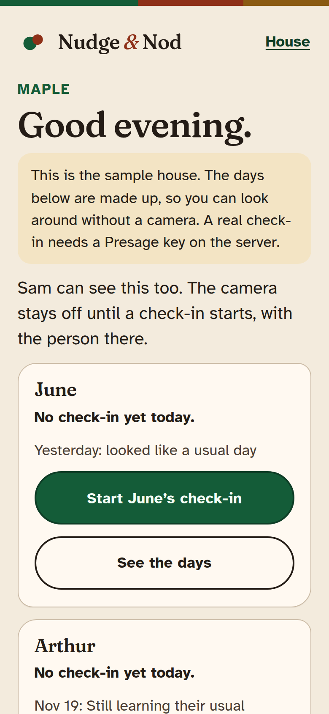
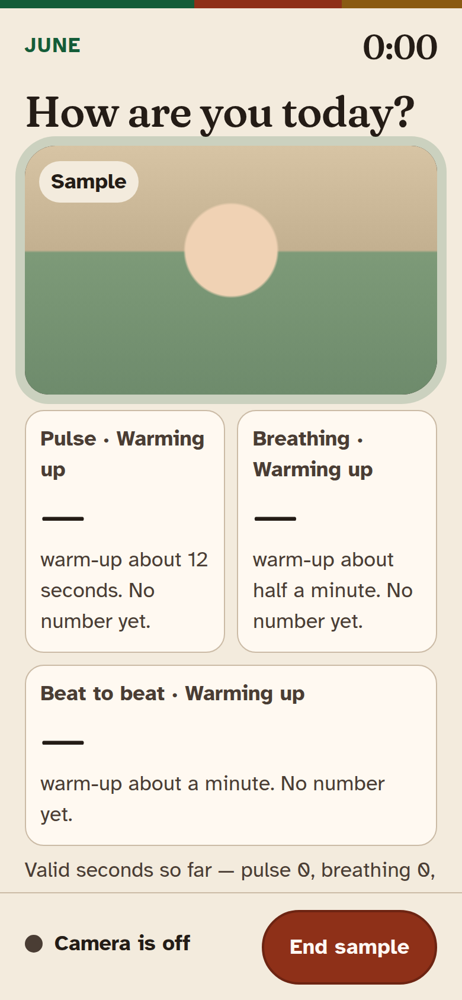
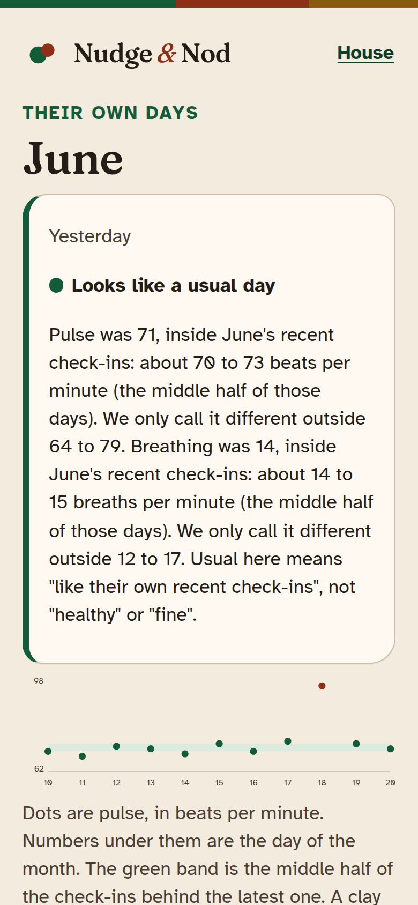
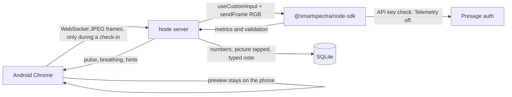

# Nudge & Nod

A calm daily check-in for someone who may not easily say how they feel, and a plain record for the family who looks after them.

A **nudge** is the gentle ask: how are you today? A **nod** is any answer. A few typed words, a big picture to tap, or simply sitting where the camera can see for about half a minute.

The phone shows a live camera preview and, when the Presage library has had long enough, the pulse and breathing it observed. The family page compares that sitting with **this person’s own recent check-ins**. It says “looks like a usual day” or “different from their usual days”. It does not diagnose anything, and it does not tell anyone what to do.

Nudge & Nod is not a medical device. If you are worried, contact a doctor or a person you trust.

## Screenshots

Taken in a phone-sized browser. Replace them with a recording from the Android phone before you publish the DEV post.







## Try it in two minutes

The sample house is already full of made-up days, so you can look around with no camera and no API key.

|            |                                                              |
| ---------- | ------------------------------------------------------------ |
| House word | `maple`                                                      |
| PIN        | `2468`                                                       |
| People     | June and Arthur are checked in. Sam holds the key with them. |

June’s latest sitting looks like her own recent days. One earlier day (a high pulse, faster breathing, the picture “Unsettled”) is marked different. Arthur does not have five steady sittings yet, so his page says we are still learning his days.

## What a check-in is

1. Someone opens the house with the word and the PIN.
2. They choose who is in front of the camera, and they agree — as that person, or with that person present.
3. The camera comes on. A “Camera is on” line and a Stop button stay on screen. Closing the page turns the camera off.
4. Frames go to this server over a WebSocket. The server runs the official `@smartspectra/node-sdk` with `useCustomInput()` and `sendFrame()`. Pulse, breathing, and (after about a minute) beat-to-beat variation come back live. Hints such as “too dark” or “hold still” are the library’s own words.
5. The person taps a picture. A note can be typed. Speaking is for the person in the room; we only keep what is typed. We do not record a voice.
6. Stop. The numbers that were steady enough are kept. The pictures are not.

There is a **sample check-in** on the same agreement screen. It plays made-up signals, leaves the camera off, and saves nothing. It is labelled Sample the whole way through.

## How “usual” is decided

These are the exact rules. They are also in the JSON export under `rules`, and in `server/src/baseline.ts`.

A pulse or breathing number from one check-in is **eligible** only when all of these are true:

1. The check-in was live, not the sample.
2. Confidence met the SDK’s own steady mark: **40** for pulse, **45** for breathing. Those marks are the library’s quality flags (about ±3 bpm and ±1 breath/min in Presage’s model cards). They are not a clinical cutoff.
3. The value sits in the range that camera method can read: pulse **40–110**, breathing **5–40**. Outside that, the number is left out and called unread.
4. The check-in contained at least **8 distinct seconds** in which that signal met the confidence mark. A second with no sample is not filled in. Two samples in the same second count as one second.

Eligible readings are then grouped by the **UTC date** of the check-in. Several sittings on the same date count as one day (the latest eligible reading that day).

- Fewer than **5 earlier days** with an eligible reading: the screen says **“Still learning their usual”**. It does not say usual or different.
- With 5 or more earlier days, the band is the middle half of up to **14** of those days, widened by a Tukey step (1.5 × the interquartile range) and by a floor of **6 bpm** or **2 breaths/min** so a flat run of days is not hypersensitive.
- Inside that spread: **“Looks like a usual day”**. Outside it: **“Different from their usual days”**.
- Usual means “like their own recent check-ins”. It does not mean healthy. Different is not a diagnosis and not a wellbeing score.

HRV (RMSSD, SDNN, mean NN), face descriptions, and the pulse shape are shown in an “all signals” line when the library produced them and, for HRV, when confidence is at least 50. They are **not** part of usual or different.

On the check-in itself, each signal is **warming up** (no number, never a zero), **live** (a number plus its confidence), or **stale** (the last number, with how many seconds ago it arrived, if the last sample is older than 3 seconds). The ring around the preview moves only while breathing is actually live. Missing trace points are not joined into a line.

## Architecture

SmartSpectra has no browser SDK. The phone captures frames. A separate process on a glibc 2.35+ Linux host runs the Node SDK, so a slow or stuck native call cannot freeze the HTTP server or the sample house. If that process does not become ready (20 seconds by default), it is killed and the check-in says Presage could not be reached. The SDK’s own docs say native state is process-global, so this server still measures **one person at a time**. A second check-in is asked to try again shortly.

Frames handed to `sendFrame` are packed RGB, not RGBA. The stride is `width * 3` (a 640×480 frame is stride 1920). Timestamps are monotonic microseconds, not wall-clock time. `PixelFormat.kRGB` and `FrameTransform.kNone` match a real-key probe on Linux x64. The blood-pressure waveform is not requested. A machine without Vulkan logs a harmless native warning; that line stays in the server log and is not shown as a failed check-in.

Render’s health check is `GET /healthz`. It does not touch the SDK, including while a measurement is starting.



Frames are JPEG at a long edge of 960 so a phone uplink can carry them. JPEG softens the tiny colour changes pulse is read from. Bright, steady light matters even more because of that hop. Frame timestamps are the phone’s monotonic clock in microseconds, which is what the SDK asks for (`kNonMonotonicTimestamp` if the clock jumps backwards). The server drops frames past 30 per second instead of queueing them.

Pulse usually needs about 12 seconds. Breathing needs about 30 seconds, and a phone that is propped rather than held. Beat-to-beat variation (HRV) needs about 60 seconds, so the check-in invites you to stay if you want that number, and does not pretend to have it before then. A face description, when the library offers one, is labelled as what the camera saw. The picture the person taps is the answer. A face is not a feeling.

LLM Insights are never called. No other AI service is used.

## Local development

Node.js 20 or newer. This machine needs glibc 2.35+ (Ubuntu 22.04+, Debian 12+) if you want a live measurement. The sample house does not need the native library, but `npm install` still downloads it.

```bash
cp .env.example .env
# optional: put a real key in SMARTSPECTRA_API_KEY
npm install
npm run dev
```

Open http://localhost:5173 . The Vite dev server proxies `/api` and `/ws` to the API on port 8787.

```bash
npm test
npm run lint
npm run build
npm start
```

`npm run probe -w server` loads the native SDK and prints its version. It only calls `start()` / `sendFrame()` when `SMARTSPECTRA_API_KEY` is set. Without a key it stops after the library loads, which is what happened in development here. See [What was and was not tested](#what-was-and-was-not-tested).

## Deploy from an Android phone

You do not need a laptop. You do need Chrome, a GitHub account, a Render account, and a Presage key. Render gives you HTTPS, which the camera requires.

### 1. Get a Presage key

1. In Chrome, open https://physiology.presagetech.com .
2. Register a free developer account.
3. Create an API key and copy it into a note on the phone. Leave that note open.

Do not put the key in the repository, in a screenshot, or in the DEV post.

### 2. Open Render

1. Open https://dashboard.render.com and sign up. “Sign in with GitHub” is the least painful path on a phone, because the next step connects this repository.
2. If GitHub asks you to authorise Render, allow it.

### 3. Create the service from this repo

This repository includes `render.yaml` (a Blueprint) and a `Dockerfile`.

1. In Render, choose **New**, then **Blueprint**.
2. Select this GitHub repository and the branch you want to deploy (after this pull request is merged, that is `main`).
3. When Render shows environment variables, paste the Presage key into `SMARTSPECTRA_API_KEY`. Leave `SMARTSPECTRA_TELEMETRY` as `false` and `SEED_DEMO` as `true`.
4. Choose the **free** instance if it is offered. If the free plan is not on the screen, the smallest paid web service works the same way.
5. Start the deploy.

The first build downloads the SmartSpectra runtime. That package depends on four platform builds, roughly 100MB each, about 350MB together. The Dockerfile installs them and then deletes the macOS, Windows, and Linux ARM builds in the same step, so the image keeps the Linux x64 runtime only. A free build can be slow. If it fails, run it once more. If it fails because the builder runs out of memory or time, use **New → Web Service**, runtime **Docker**, and the same environment variables. The Dockerfile is the same either way.

A non-Docker fallback, if you would rather use Render’s Node runtime (the host must be Ubuntu 22.04 or newer):

- Build command: `npm ci && npm run build && rm -rf node_modules/@smartspectra/node-sdk-darwin-arm64 node_modules/@smartspectra/node-sdk-win32-x64 node_modules/@smartspectra/node-sdk-linux-arm64`
- Start command: `npm start`
- Node version: 22

### 4. Open it on the phone

1. When the service is live, open the `https://….onrender.com` address.
2. The first open after the service has been asleep can sit on “Waking the house up” for a minute. That is the free tier starting, not a broken page. Pull to refresh if it sits longer than two minutes.
3. Tap **Look around the sample house**, or come in with house word `maple` and PIN `2468`.
4. Walk the sample check-in first. The camera stays off.
5. For a live check-in, start June’s (or anyone’s) check-in, agree with them present, and tap **Start the camera**. Chrome will ask for the camera. Allow it. Prop the phone. Stop is on the screen the whole time.

### Things the free host will do

- **Sleep.** After a while with no visitors the service turns off. The next visit wakes it.
- **Forget the database.** The free disk is ephemeral. A restart or a new deploy can wipe check-ins. The sample house is recreated on boot if it is missing. Do not treat this as the only copy of a real record. The one-page summary can be printed or shared before that happens.
- **Run one measurement at a time.** A second check-in is told to wait.
- **Possibly run out of memory** once the native models are in use. Loading the library alone was about 110MB of resident memory in development. A real measurement loads more. If a live check-in dies as soon as it starts and the Render log shows the process exiting, move the service to an instance with more than 512MB of RAM.

Do not turn on more than one instance. The SDK session and the SQLite file are both local to the one process.

## Deploy on Hugging Face Spaces

The same Docker image runs on a free Hugging Face Space (2 vCPU, 16 GB). The app listens on the `PORT` environment variable. Spaces sets that to **7860**, and the README front matter tells the Space proxy to use that port. Render sets its own `PORT`; both hosts work without a code change.

1. Create a new Space. Choose **Docker** as the SDK. You can point it at this repository.
2. In Space settings, add a secret named `SMARTSPECTRA_API_KEY`. Do not put the key in the Dockerfile or the README.
3. Leave `SMARTSPECTRA_TELEMETRY` unset or `false`.
4. The container runs as uid 1000. Check-ins are stored in `/data`, which is writable by that user. A free Space disk is ephemeral, same as Render’s free disk: a restart can forget the days. The sample house is recreated if it is missing.
5. Open the Space URL over HTTPS and allow the camera only when a check-in starts.

## For judges

- House word `maple`, PIN `2468`. Also printed on the welcome screen.
- The days are made up. June shows both “usual” and “different”. Arthur shows “still learning”.
- **Try the sample instead** on the agreement screen runs the full check-in UI with sample signals and no camera. Use this if the key, the camera, or the cold start is in the way.
- A live check-in needs `SMARTSPECTRA_API_KEY` on the server. The home page says when the key is missing.
- Settings includes retention (7, 30, or 90 days), **Delete all our data**, and, in the sample house, **Restore sample days**.
- The one-page summary prints to PDF from Chrome’s share or print sheet.
- Tests: `npm test`. They cover the comparison and the HTTP routes. They do not call Presage.

## Consent and data handling

### Camera consent

The camera is off until a person starts a check-in, after an agreement screen. The agreement asks who is in front of the camera and who is agreeing. A carer can agree only by saying the person is there with them. The camera preview is on screen, with the words “Camera is on” and a Stop control that stays put. Leaving the page or stopping the check-in stops the tracks. There is no background capture and no second hidden camera.

### What is stored

SQLite, in `DATA_DIR` (default `./data`). Migrations are applied on boot and recorded in `schema_migrations`.

Kept: household word, PIN hash (scrypt), names, and agreement records. An agreement stores who agreed (their name), who the check-in was for, whether they agreed as themselves or with the person present, the time, and the text version (`2026-11-21.2`). Withdrawing an agreement stops capture. It does not delete history. Deleting is a separate control.

A check-in stores the time, why it ended (stop, withdraw, drop, or the three-minute cap), the picture tapped, a typed note up to 280 characters, and derived numbers: pulse, breathing, optional HRV, a short face description, confidence, how many samples arrived, how many seconds were steady enough, and a small trace of those numbers. The trace keeps gaps. It does not store a zero where a sample was missing.

Not kept: video, frames, audio, raw landmarks. Frames are not written to the log. Logs redact notes, PINs, and the API key.

### Where frames go

During a live check-in, JPEG frames travel from the phone to **this** server. The SmartSpectra library on that server reads them in memory. Presage’s documentation says metric computation runs inside the SDK, and that the Presage service is contacted to authenticate the API key and validate the subscription.

### Who can see it

Anyone with the house word and the PIN. That is the whole share list inside the app. A printed or shared summary is a copy you made; deleting data here does not delete that copy.

The PIN is a small demo lock: 4–6 digits, hashed, and slowed after repeated misses. It is not an appropriate lock for a real clinical record.

### Retention and deletion

Default 30 days, changeable to 7 or 90 in House. Older check-ins are deleted on a timer and on boot. **Delete all our data** removes check-ins, notes, and agreements immediately. Names and the house word stay so you can still come in. On Render’s free plan the disk itself may also disappear on restart. That is stated in the app.

### Frames

During a live check-in, JPEG frames travel from the phone to **this** server. They are held in memory only long enough for `sendFrame`. They are not written to disk, not written to the log, and not shared onward as pictures. The phone keeps the preview locally.

### SDK telemetry, and the traffic that is not optional

Telemetry is **off** (`enableTelemetry: false` unless `SMARTSPECTRA_TELEMETRY=true`).

That switch covers optional session summaries and device-readiness reports. If it were on, Presage’s [telemetry documentation](https://smartspectra.presagetech.com/docs/telemetry-and-privacy) says the SDK sends session summaries and, for a readiness check, a full diagnostic report. Summaries can include SDK version, OS, CPU, input kind (camera, file, or custom frames), outcome, metric count, frame-rate statistics, counts of validation states, a coarse error code, and a timestamp. Readiness reports can also include free text such as paths, device model, and thresholds. Reports are sent on an authenticated request, so they can be tied to the API key’s account. They do not include raw frames or measured vital signs. Presage says those reports do not currently expire on their own. Do not describe them as anonymous.

Turning telemetry off does **not** make the app offline. A live check-in still contacts Presage to authenticate the API key and let the library set itself up. That traffic is required by the SDK. The library is proprietary, so this project does not claim to have audited every request it makes. The key stays in the server environment and is never sent to the browser.

### Export

House → **Download JSON** saves names, agreements, moods, notes, numbers, and the valid-second counts. It does not contain video, and it does not delete anything.

### AI

None. The SDK’s LLM Insights feature is never called. Speech is not sent to a recognition service. The optional “few words” are typed.

### What this is not

Not a medical device. Not a diagnosis, a treatment, or a decision about care. “Usual” and “different” describe this household’s own recent check-ins. If you are worried, contact a doctor or a person you trust.

## What was and was not tested

Tested here:

- `npm test`: the comparison (including the made-up June series), metric decoding, JPEG frame packing, and the HTTP routes (login, consent, story, summary, delete, sample restore).
- `npm run build` for the server and the web app.
- Loading `@smartspectra/node-sdk` 3.5.0 on Linux x64, glibc 2.39. The native module loaded. Resident memory after import was about 110MB. `PixelFormat.kRGB` is 0 and `FrameTransform.kNone` is 0, matching the docs.
- The sample house and sample check-in in a browser, without a camera. See the screenshots.

Not tested here:

- A real face in front of a phone camera, end to end. There is no camera on this machine, and no Presage API key in the environment.
- `sdk.start()` and `sendFrame()` against Presage. A probe that constructed the SDK with a dummy key opened a TLS connection and did not return within ten minutes, so the process was stopped. That blocks the Node thread inside the constructor; the HTTP server would be stuck for the same wait. With a real key on Render the call should return. If it does not, the check-in cannot start and the sample check-in is the path that still works. Do not restart a failed measurement automatically; the SDK docs say a sustained low frame rate is retryable for custom input but must be started again by the person.
- Breathing and pulse accuracy. The library’s confidence is shown as the library reports it. It is not a claim about correctness.

## SDK notes that shaped the design

- Metrics are for general wellness information. They are not FDA cleared. Copy in the app repeats that.
- Unavailable metrics (`BREATHING_AMPLITUDE`, `APNEA`, and the other three listed in the Node metrics guide) are not requested. Requesting them makes `start()` fail.
- Requested signals: breathing bundle, pulse, HRV, the relative arterial-pressure **shape** (never labelled as blood pressure), expressions, and talking. Face landmarks are not requested; there are hundreds of points and we do not need them.
- Validation hints are shown as the SDK sends them. Our own lines only fill in when the hint is empty.
- `kSustainedLowFrameRate` stops the session. The app tells the person and does not start it again by itself.
- `checkDeviceReadiness()` is called when the method exists. A `blocked` verdict stops the check-in. Other failures are logged and the phone is still allowed to try, because this server has no camera of its own. Custom frames are the input.
- Decode with `@smartspectra/node-sdk/messages`. The root `decodeMetrics` returns a raw buffer unless a class is registered first. That is called out in the headless-testing doc, and the code follows it.

## Credits

- The custom-input calls follow the [SmartSpectra Node.js documentation](https://smartspectra.presagetech.com/docs/nodejs): `useCustomInput`, `sendFrame`, and `decodeMetrics` from `@smartspectra/node-sdk/messages`. The Electron quickstart is the desktop reference for the same SDK. Its UI was not copied.
- [Lexend](https://www.lexend.com/) by Bonnie Shaver-Troup and Thomas Jockin, SIL Open Font License, self-hosted through Fontsource. Chosen because it was designed to reduce visual stress and improve reading for people who find reading hard.

MIT licensed. See [LICENSE](LICENSE).
